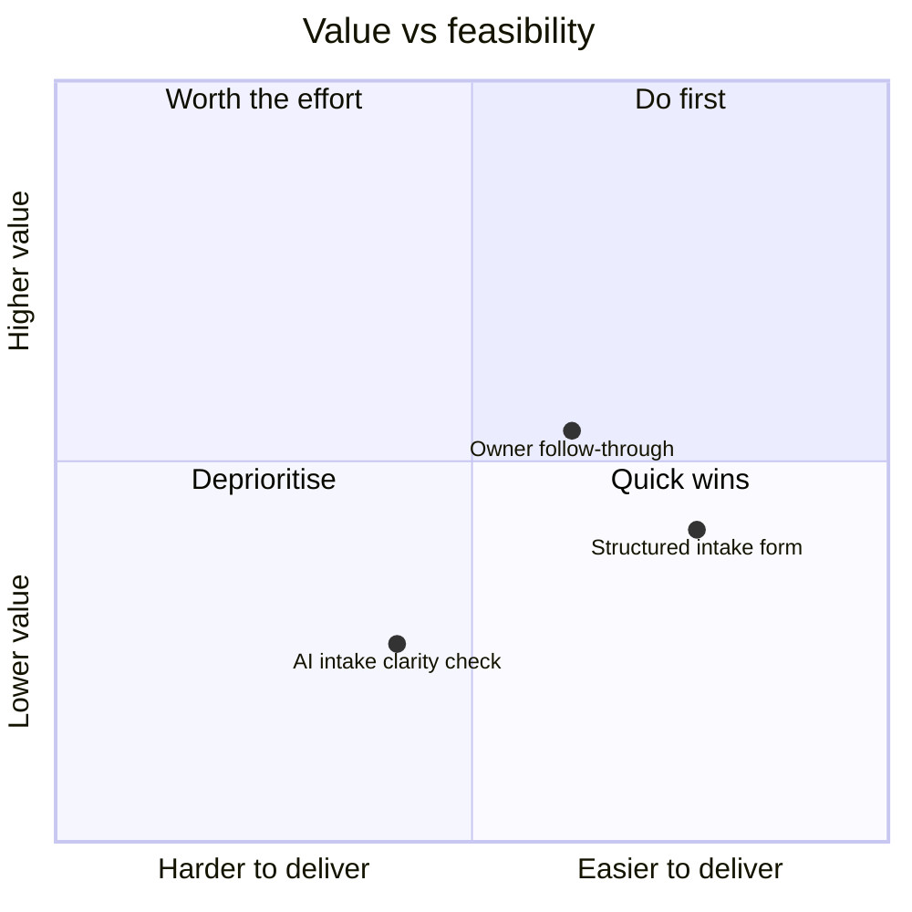

# Exec brief: fixing stalled feedback at Tessellate

*Generated by `business_case/brief.py` from 25 weeks of event data. Synthetic data; costs are assumptions. Do not edit by hand.*

**Today**, product ops spends about 1,040 hours a year chasing feedback (SGD 62k at SGD 60/hour).

## Recommendation

**Fund Owner follow-through first.** It saves about 340 product ops hours a year and returns a median SGD 31k over three years (SGD 16k to SGD 46k), paying back in about 13 months.

**Structured intake form is the quick win:** the cheapest to build (about SGD 6k), paying back in about 12 months. It targets clarification requests, not nudges and escalations, so the two can run together.

**AI intake clarity check does not pay back on hours alone:** only a 13% chance of a positive 3-year return. Its case rests on rescuing items now lost to unanswered questions and getting feedback to owners faster, which this ROI does not count.

## The options

| Option | Targets | Saved / yr | 3-year net (P10 – P50 – P90) | 3-year ROI | Payback | Chance ROI > 0 | Feasibility (1–5) |
|---|---|---|---|---|---|---|---|
| Owner follow-through | nudges and escalations | 340 h · SGD 20k | SGD 16k – SGD 31k – SGD 46k | 103% | 13 months | 100% | 3.5 |
| Structured intake form | clarification requests | 108 h · SGD 6k | SGD 5k – SGD 11k – SGD 17k | 145% | 12 months | 100% | 4.1 |
| AI intake clarity check | clarification requests | 216 h · SGD 13k | −SGD 24k – −SGD 11k – SGD 1k | −21% | 68 months | 13% | 2.6 |

*Medians of 10,000 simulated runs. ROI: undiscounted, 3 years, product ops hours only.*

## Value vs feasibility

*Value: median 3-year net benefit, fixed scale −SGD 50k to SGD 100k. Feasibility: weighted score of five criteria.*

## What each option rests on

- **Owner follow-through** rests on owners acting on digests and an ageing view instead of waiting for one-off nudges. Most sensitive to the share of targeted effort saved: SGD 10k to SGD 59k over three years.
- **Structured intake form** rests on providers filling in mandatory fields properly rather than with filler. Most sensitive to the share of targeted effort saved: SGD 3k to SGD 23k over three years.
- **AI intake clarity check** rests on rescuing items now lost to unanswered questions and getting feedback to owners faster. Most sensitive to the build effort (engineer-weeks): −SGD 25k to SGD 7k over three years.

## Not counted in the ROI

- **Owner follow-through:** 3,464 nudges and escalations avoided a year.
- **Structured intake form:** about 47 lost items rescued and 651 clarification requests avoided a year.
- **AI intake clarity check:** about 111 lost items rescued and 1,301 clarification requests avoided a year.
- Provider and owner time, faster delivery, and the time value of money.

## Next steps

1. Confirm costs with engineering and finance; test the feasibility scores with product ops and an owner.
2. Pilot **Owner follow-through** and measure the real reduction in nudges and escalations against the 50% assumed.
3. Prototype **AI intake clarity check** cheaply and measure the outcomes its case rests on before funding a full build.
